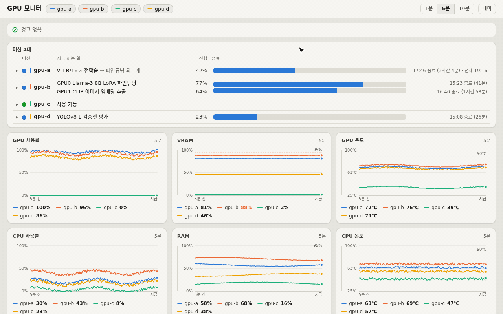
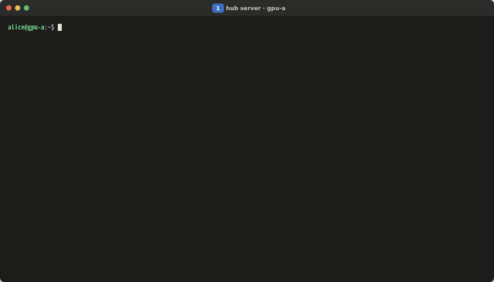
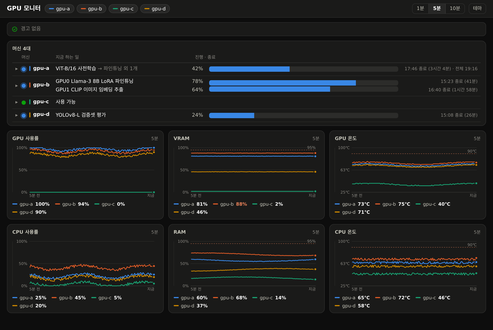
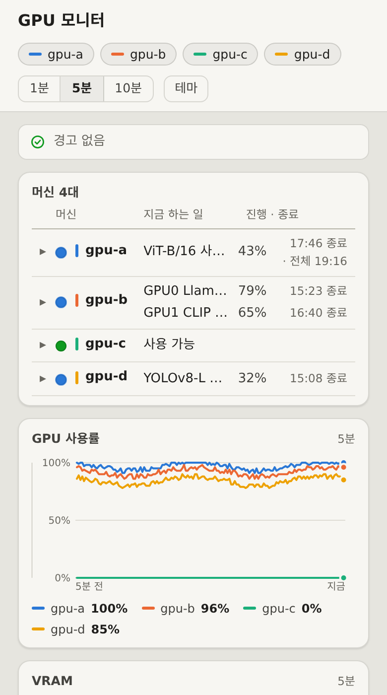
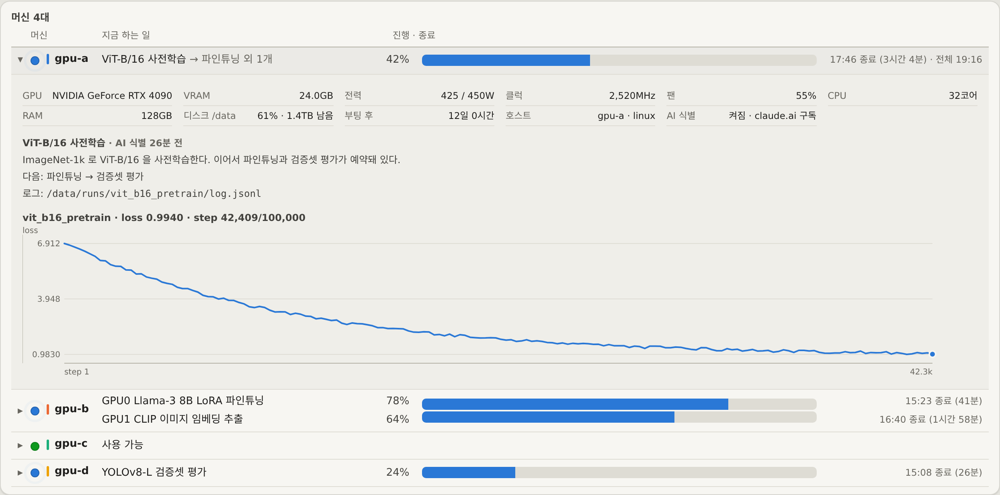

<h1 align="center">GPU 모니터</h1>

<p align="center">
  <b>어느 GPU 서버가 지금 무엇에 쓰이는지, 한 화면에.</b><br>
  Claude Code 가 GPU 작업이 무엇인지 알아내고, 진행률·종료 시각은 그 작업의 로그에서 바로 읽는다.
</p>

<p align="center"><a href="README.md">English</a> · <b>한국어</b></p>

<p align="center"></p>

## 설치

**1. hub** — 팀에 하나

```bash
git clone https://github.com/zoo3323/gpu-monitor.git && cd gpu-monitor
./install.sh hub
```

**2. GPU 서버마다** — hub 가 알려 준 한 줄을 붙여 넣는다

```bash
curl -fsSL "http://HUB:8787/install.sh?t=TOKEN" | bash
```

**3. AI 작업 식별** — 서버마다 한 번

```bash
claude auth login
```

<p align="center"></p>

## 화면

<table>
  <tr>
    <td width="70%"></td>
    <td></td>
  </tr>
  <tr>
    <td colspan="2"></td>
  </tr>
</table>

<sub>Linux + NVIDIA · Python 3.7 이상 · 작업 식별에 <a href="https://claude.com/claude-code">Claude Code</a>(선택) · <a href="docs/DETAILS.ko.md">자세히</a> · MIT</sub>
