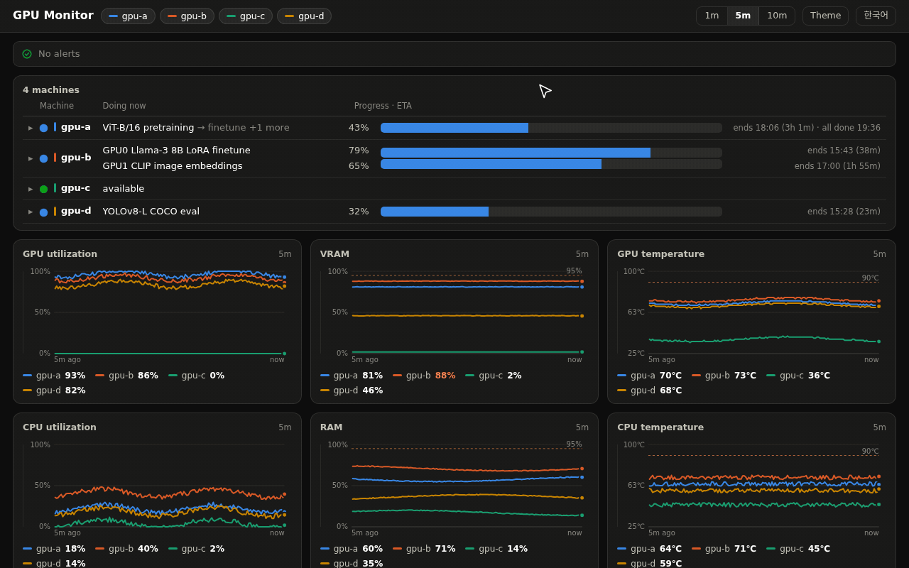
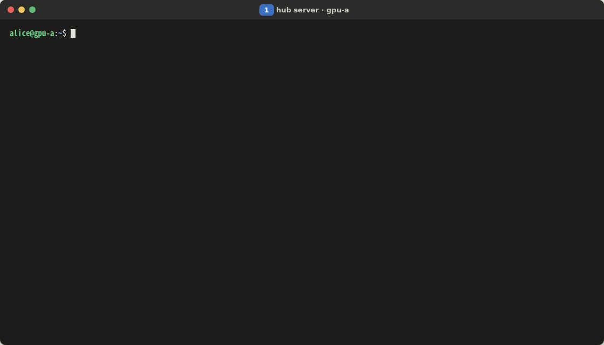
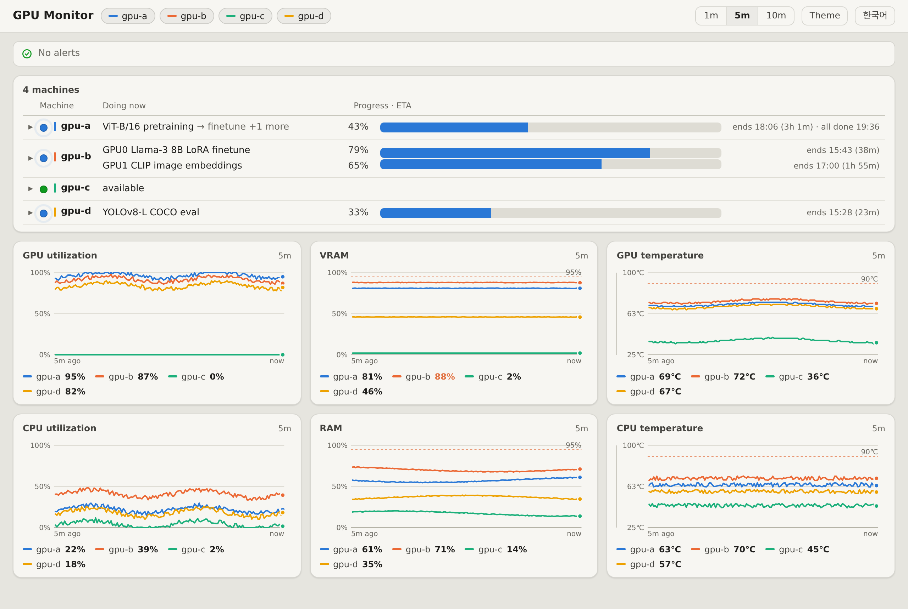
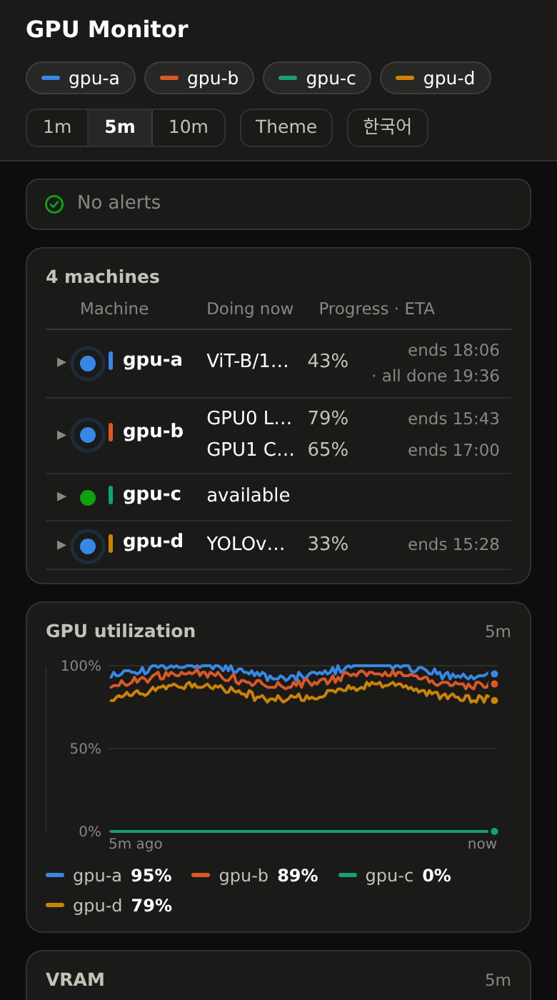
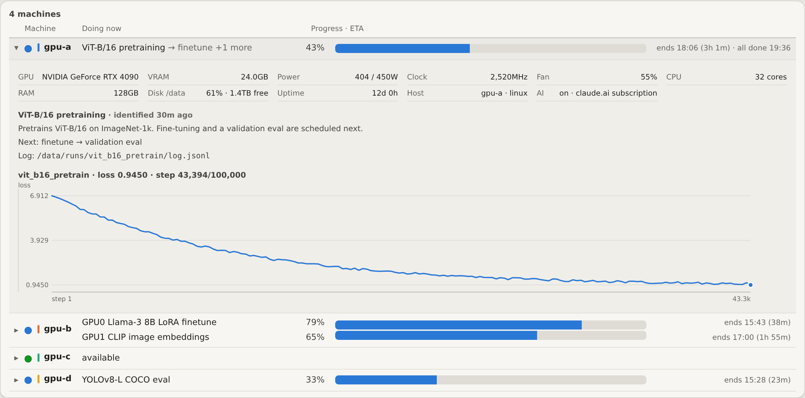

<h1 align="center">GPU Monitor</h1>

<p align="center">
  <b>Which GPU servers are busy, and with what — on one screen.</b><br>
  Claude Code names each GPU job. Progress and ETA come straight from its logs.
</p>

<p align="center"><b>English</b> · <a href="README.ko.md">한국어</a></p>

<p align="center"></p>

## Install

**1. Hub** — one per team

```bash
git clone https://github.com/zoo3323/gpu-monitor.git && cd gpu-monitor
./install.sh hub
```

<sub>Port 8787 by default (a free one is picked if it's taken) · <code>--port 9000</code> · <code>--lang ko</code> for a Korean screen</sub>

**2. Each GPU server** — paste the line the hub prints

```bash
curl -fsSL "http://HUB:PORT/install.sh?t=TOKEN" | bash
```

**3. Job names by AI** — once per server

```bash
claude auth login
```

<p align="center"></p>

## Screens

<table>
  <tr>
    <td width="70%"></td>
    <td></td>
  </tr>
  <tr>
    <td colspan="2"></td>
  </tr>
</table>

<sub>Linux + NVIDIA · Python 3.7+ · <a href="https://claude.com/claude-code">Claude Code</a> for job names (optional) · English / 한국어 · <a href="docs/DETAILS.md">Details</a> · MIT</sub>
